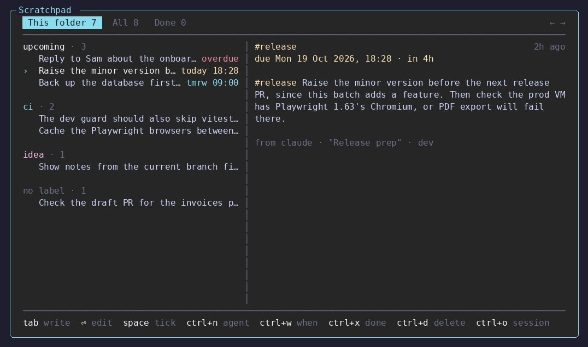
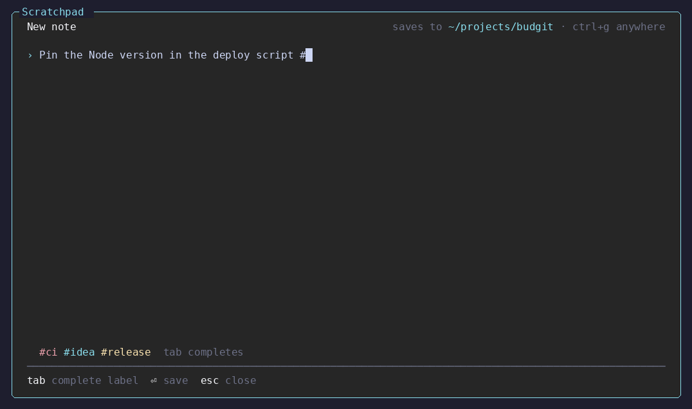
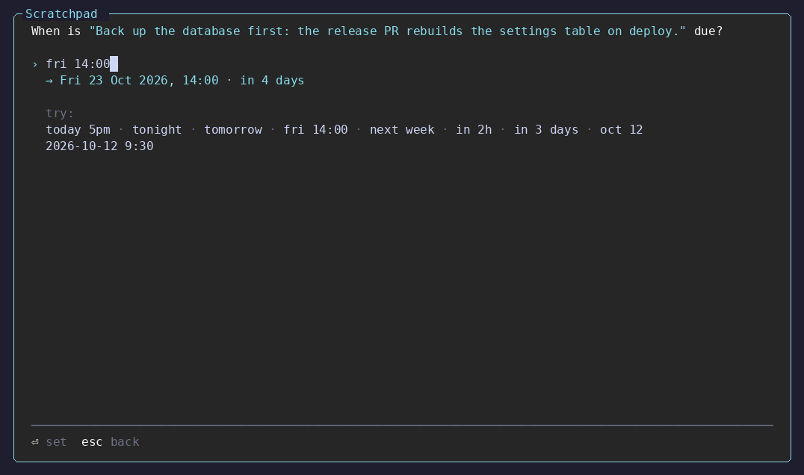

# Scratchpad

A [Herdr](https://herdr.dev) plugin for the ideas you get while an agent is
busy. Press a key, type the note, and go back to what you were doing. Notes go
into one global scratchpad and are tied to the folder or repo you were in.
Later you can hand them to an agent.



- Label notes with `#hashtags`, and give a note a date to pin it to the top.
- Each note records where it came from: the folder (the git root if there is
  one), the branch, and the agent and session that were in front of you.
- Hand notes to an agent through [Quick Prompt](https://github.com/Taanviir/herdr-quick-prompt):
  a new one in a tab, split or worktree, or one that is already running.
- Reopen the Claude Code or Codex session a note came from.
- Agents read and write the same notes with the `scratch` command.
- No dependencies, no build step. Node 18 or newer.

## Install

```bash
herdr plugin install Taanviir/herdr-scratchpad
herdr plugin action invoke taanviir.scratchpad.setup
herdr plugin install Taanviir/herdr-quick-prompt   # to hand notes to agents
```

Setup binds **ctrl+b** then **a** in your `config.toml`, and links `scratch`
into `~/.local/bin`. Set `SCRATCHPAD_KEY` first to use another key, and
`SCRATCHPAD_BIN_DIR` to link `scratch` somewhere else. A key that is already
bound is left alone.

## The popup

The popup opens on an empty page for writing. Type, press ⏎, and the note is
saved under the folder you were in; the page clears for the next one.

`tab` turns to your notes: grouped by label on the left, the selected one in
full on the right with where it came from. `←` and `→` switch between **This
folder**, **All** and **Done**. Notes filed under a parent folder also show up
in its subfolders. `tab` turns back to the page, with whatever you were writing
still on it.

**Labels.** Any `#word` in a note is a label: `back up the db first #release`.
Notes are grouped under their first label. Typing `#` suggests labels you
have used before, and `tab` completes one.



**Dates.** `ctrl+w` on a note asks when it is due. Dated notes move into an
**upcoming** group at the top of the list, soonest first: overdue in red,
today's in yellow. Type the date the way you would say it, and the line under
the field shows how it was read before you press ⏎:

| You type | It means |
| --- | --- |
| `today 5pm`, `17:00`, `9:30am` | today at that time, or tomorrow if it has passed |
| `tonight` | today at 20:00 |
| `tomorrow`, `fri`, `next week` | that day at 09:00 |
| `fri 14:00`, `tomorrow at 9am` | that day at that time |
| `in 30 min`, `in 2h`, `in 3 days`, `in 1w` | that long from now |
| `oct 12`, `12 oct`, `2026-10-12 14:00` | that date, at 09:00 unless a time is given |

⏎ on an empty field clears the date. Ticked notes all get the same date.



**Writing a note**

| Key | |
| --- | --- |
| `⏎` | save |
| `\` `⏎`, `shift+⏎`, `alt+⏎`, `ctrl+j` | new line; many terminals send `shift+⏎` as a plain `⏎`, so a backslash before `⏎` works everywhere |
| `ctrl+g` | save under no folder instead, or back |
| `ctrl+v` | paste from the system clipboard |
| `tab` | complete a label, or turn to the notes |
| `esc` | close, keeping what you typed |

**In the notes**

| Key | |
| --- | --- |
| `tab` | back to writing |
| `←` `→` | this folder, all, done |
| `⏎` | edit the note on the writing page; ⏎ saves it, `esc` leaves it as it was |
| `space` | tick a note; actions apply to the ticked notes, or the one under the cursor |
| `ctrl+n` | hand the notes to an agent, through Quick Prompt |
| `ctrl+w` | set or clear the date the notes are due |
| `ctrl+x` | mark done, or reopen |
| `ctrl+d` twice | delete |
| `ctrl+o` | reopen the Claude Code or Codex session the note came from |
| `esc` | close |

Typing a letter in the notes turns back to the page with it.

**Handing notes to an agent.** `ctrl+n` opens Quick Prompt with the notes
already written as its prompt, in the notes' folder. From there it is Quick
Prompt as usual: pick the agent, a tab, split or worktree, and ⏎ to launch, or
`ctrl+r` to send the notes to an agent that is already running. The prompt
lists each note with its id and asks the agent to run `scratch done <id>` when
it finishes one. Without Quick Prompt installed, `ctrl+n` says how to get it.

It works the other way too: `ctrl+s` in Quick Prompt saves the prompt you were
about to launch here as a note, for when it is not the right time.

## For agents

```text
scratch add "the dev guard should also skip vitest"   # note for this folder
scratch add --anywhere -  < idea.md                    # from stdin, no folder
scratch list                                           # open notes here
scratch list --all --json
scratch list --label release                           # only #release notes
scratch add --due "fri 14:00" "send the release notes" # dated; lists first
scratch due <id> tomorrow                              # or: scratch due <id> none
scratch show <id>
scratch done <id>
```

Ids can be shortened to any unique prefix. To let agents use it on their own,
add something like this to your `AGENTS.md` or `CLAUDE.md`:

```markdown
## Scratchpad
- `scratch list` shows my open notes for this repo. Check it at the start of a task.
- When you notice something out of scope, `scratch add "<what and why>"` instead of doing it.
- When you finish a note you were given, `scratch done <id>`.
```

## Files

| Path | |
| --- | --- |
| `~/.local/share/herdr-scratchpad/notes.jsonl` | the notes, one per line (`SCRATCHPAD_HOME` moves it) |
| plugin state dir, `draft.txt` | the unsaved note |
| plugin state dir, `crash.log` | errors from the popup |

The plugin state directory is normally
`~/.local/state/herdr/plugins/taanviir.scratchpad/` on Linux.

## Developing

```bash
herdr plugin link .
npm test
```

Changes take effect the next time the popup opens. `ctrl+n` and `ctrl+o` open
real popups and agents. Point `HERDR_BIN_PATH` at a stub to exercise them
without that.

The README images are drawn from the popup's real output, against fixture
notes, so they cannot drift from what the code prints:

```bash
D='\x1b[B'
uv run --with pillow tools/screenshot.py docs/scratchpad.png --keys '\t' $D
uv run --with pillow tools/screenshot.py docs/scratchpad-labels.png --type 'Pin the Node version in the deploy script #'
uv run --with pillow tools/screenshot.py docs/scratchpad-when.png --keys '\t' $D $D '\x17' 'fri 14:00'
```

## Releasing

The version lives in `herdr-plugin.toml` and `package.json`, and the two must
match. Merging a version bump to `main` runs the tests and publishes `vX.Y.Z`
as a GitHub release. Install a specific release with
`herdr plugin install Taanviir/herdr-scratchpad --ref vX.Y.Z`.

## License

[MIT](LICENSE).
